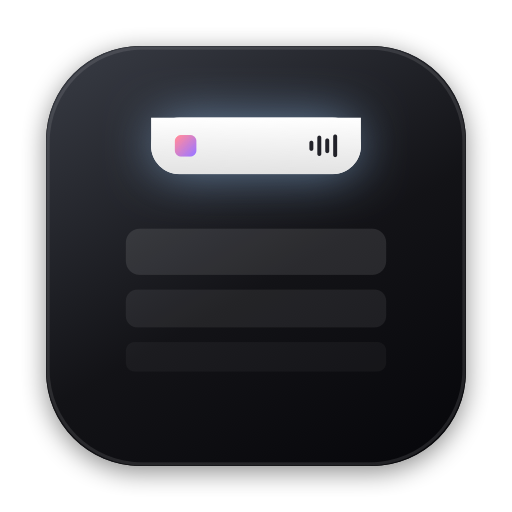
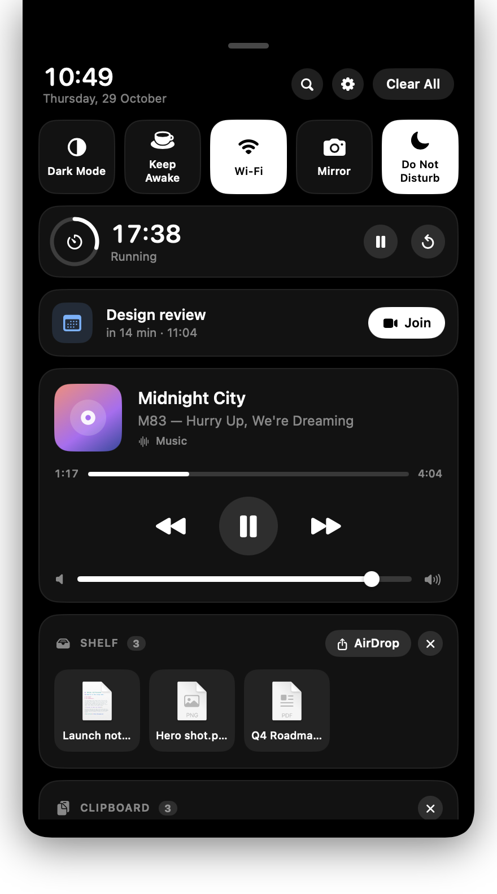

<p align="center">
  
</p>
<h1 align="center">NotchIsland</h1>
<p align="center">Your MacBook notch, now a Dynamic Island.<br>
<a href="https://edwardrem.github.io/NotchIsland/">Website</a> ·
<a href="https://github.com/Edwardrem/NotchIsland/raw/main/dist/NotchIsland.dmg"><b>Download NotchIsland.dmg</b></a> ·
<a href="https://github.com/Edwardrem/NotchIsland/releases">Releases</a><br>
<sub>Made by <a href="https://www.linkedin.com/in/rufaro-mutepfa-0a64b810a/">Rufaro Edward Mutepfa</a></sub></p>

<p align="center">
  
</p>

NotchIsland turns the MacBook notch into a Dynamic Island. The whole UI is one true-black surface
that flows out of the notch (flat top, rounded bottom, one width): compact "ears" when something is
live, a short HUD for live activities, a hover readout, and a click-down shade with a clock, quick
toggles, timer, next event, Now Playing, shelf, clipboard and notifications grouped by app.
⌥ Space opens a Spotlight-style launcher with fuzzy app search, calculator, unit conversion, file
search and quick actions. Free, open source (MIT), macOS 13+, Apple silicon.

## Install

1. Download [NotchIsland.dmg](https://github.com/Edwardrem/NotchIsland/raw/main/dist/NotchIsland.dmg)
   and drag **NotchIsland** into Applications.
2. First launch: macOS says *"Apple could not verify NotchIsland is free of malware"*. That is
   Gatekeeper noticing the app is not notarized (it is signed with the project's own certificate,
   not a paid Developer ID). To open it anyway:
   - **macOS 15 and later**: click **Done**, then System Settings ▸ Privacy & Security ▸ scroll to
     *"NotchIsland was blocked"* ▸ **Open Anyway** ▸ **Open**.
   - **macOS 13 / 14**: right-click NotchIsland in Applications ▸ **Open** ▸ **Open**.
   - Or from Terminal: `xattr -dr com.apple.quarantine /Applications/NotchIsland.app`

   The DMG carries a *Read me first.txt* with the same steps.
3. For notifications, give NotchIsland **Full Disk Access**: System Settings ▸ Privacy & Security ▸
   Full Disk Access ▸ turn on **NotchIsland** (click **+** and pick it from Applications if it is not
   listed), then relaunch. Until then the island shows a hint; click it to jump to that pane.
4. Accessibility (hotkey) is asked for on first launch; everything else when you first use it (see
   [Permissions](#permissions)). Settings ▸ Permissions shows the state of each.
5. From here on NotchIsland updates itself: it checks GitHub once a day and says so in the island
   when a new version is out. Settings ▸ Updates shows what's new, and **Update Now** installs it
   in place, keeping every grant and skipping the Gatekeeper dialog (nothing goes through a browser).
6. Updating from an earlier version and a switch that is on in System Settings does not work? See
   [Allowed in System Settings but not working](#allowed-in-system-settings-but-not-working).

## Run from source

```bash
git clone https://github.com/Edwardrem/NotchIsland.git
cd NotchIsland
swift run            # builds and launches
```

Or open `Package.swift` in Xcode and press ⌘R. Requires macOS 13+ and Xcode 15+.
The bare executable embeds its own Info.plist (bundle id `com.notchisland.app`, `LSUIElement`, privacy
usage strings), so permission prompts name the app properly even when it is not in an `.app` bundle.

## Build the app and DMG

```bash
scripts/signing-identity.sh   # once per Mac: creates the "NotchIsland Developer" signing identity
scripts/make-dmg.sh 1.2.0     # release build → dist/NotchIsland.app → dist/NotchIsland.dmg
```

`Resources/Info.plist` is the bundle template, `Resources/AppIcon.icns` the icon (drawn by
`scripts/icon.swift`). The DMG is committed under `dist/` so the website can link to it directly.

Releases are signed with a self-signed "NotchIsland Developer" certificate kept in its own keychain
(`~/Library/Keychains/notchisland-signing.keychain-db`, never committed). macOS ties permission
grants such as Full Disk Access to the app's signature, and an ad-hoc signature changes with every
build, so a stable identity is what lets those grants survive updates. `Resources/release-identity.sha1`
records the certificate's SHA-1 (the hash macOS stores with every grant); `make-dmg.sh` refuses a
build signed with any other certificate unless `NEW_IDENTITY=1`, and an ad-hoc build unless
`ALLOW_ADHOC=1`, because either would make every user grant everything again.
`scripts/signing-identity.sh --fingerprint` prints the current certificate. Back up the keychain.

### Notarized builds (no Gatekeeper dialog)

Only a notarized app opens without the *"could not verify"* dialog, and notarization needs a paid
[Apple Developer Program](https://developer.apple.com/programs/) membership. Once you have one:

1. Create a **Developer ID Application** certificate (Xcode ▸ Settings ▸ Accounts ▸ Manage
   Certificates, or developer.apple.com ▸ Certificates) so it is in your login keychain.
2. Store notarization credentials once, using an app-specific password from appleid.apple.com:
   `xcrun notarytool store-credentials NotchIsland --apple-id you@example.com --team-id TEAMID --password app-specific-password`
3. Build: `NOTARY_PROFILE=NotchIsland scripts/make-dmg.sh 1.0.2`

`make-dmg.sh` then signs with the hardened runtime and `Resources/NotchIsland.entitlements`,
notarizes and staples both the app and the DMG. This path is written to Apple's documented flow but
has not been exercised yet (no Developer ID on hand). Switching identities changes the app's code
requirement, so users grant Full Disk Access and Accessibility once more after that first notarized
release.

## Feature matrix

Legend: ✅ done · ◐ partial · ✗ not in this build (reason in the notes below).

### Core island behaviour
| Feature | | Notes |
|---|---|---|
| Pixel-accurate notch (width/height from `NSScreen`), flat top, rounded bottom, true black | ✅ | `NotchGeometry`, `IslandSurfaceShape` |
| Hover-to-expand with spring; auto-collapse on leave; configurable hover delay | ✅ | Reduce Motion respected |
| Click opens the full shade | ✅ | Clock header, quick toggles, cards, grouped notifications |
| Drag-into-island detection | ✅ | Island expands with a drop target; files land on the Shelf |
| Every Space, over full-screen apps | ✅ | `canJoinAllSpaces`, `fullScreenAuxiliary`; optional "hide in full screen" |
| Multi-monitor | ◐ | Lives on the notched display; 200 pt stand-in on Macs without a notch |
| Idle / quiet mode | ✅ | Collapsed = just the notch |
| Do Not Disturb / Focus | ◐ | Focus *status* is shown (ears, hover, shade); toggling Focus has no public API |

### Live activities
| Feature | | Notes |
|---|---|---|
| Now Playing: art, title/artist, progress, play/pause/skip, scrubbing | ✅ | Music, Spotify, VLC via AppleScript; Safari and every Chromium browser (Chrome, Brave, Edge, Arc, Vivaldi, Opera, Chromium, beta/dev/canary channels) via page JavaScript (one-time browser switch, see Permissions) |
| Multiple sources: every player and every browser tab with media is a stream | ✅ | The island follows the stream that started most recently (audible before muted), stays put while nothing plays, and lists the others as chips in the media card; tap one to switch, click the artwork to jump to its tab |
| Volume HUD | ◐ | Island shows a volume HUD on change (1 s poll). The stock macOS overlay is **not** suppressed |
| Brightness HUD | ✗ | Needs private CoreDisplay APIs |
| Battery: charger plug/unplug activity, low-battery (20/10/5 %) warnings | ✅ | IOKit power-source notifications |
| Timer / Pomodoro with countdown ring | ✅ | Presets, ring in the ears, chime + activity when done; `timer 25` in the launcher |
| Calendar next event + join link | ✅ | EventKit; Zoom/Meet/Teams/Webex… links get a Join button |
| Notification mirroring | ✅ | Banner in the island + app-grouped shade with history |
| Downloads progress (Safari/Chrome/Finder) | ✅ | Watches `~/Downloads`; Safari gives real %; completion activity. Stale partials ignored |
| Screen recording / mic / camera indicators | ◐ | Mic (CoreAudio) and camera (AVFoundation) ✅; screen recording ✗ (no public signal) |
| AirPods/Bluetooth connect with per-bud battery | ✅ | IOBluetooth connect/disconnect; L/R/Case % from the IO registry |
| Focus mode status | ✅ | |
| Clipboard history | ✅ | Last 25 text items; concealed/transient (password-manager) items skipped |

### Launcher / productivity
| Feature | | Notes |
|---|---|---|
| Fuzzy app search, recent/frequent ranking, keyboard navigation | ✅ | |
| Global hotkey that swallows the keystroke, configurable | ✅ | CGEvent tap when Accessibility is granted; falls back to observe-only monitors |
| Calculator | ✅ | Safe recursive-descent evaluator; ↩ copies |
| Unit conversion | ✅ | length, mass, temperature, volume, speed, data (`5 km to mi`, `100 f in c`) |
| Currency conversion | ✗ | Needs a rates API/key |
| File search | ✅ | Spotlight (`NSMetadataQuery`) from 3+ characters |
| Quick actions: lock, sleep, empty trash | ✅ | plus dark mode, keep-awake, Wi-Fi, mirror, settings |
| Shelf / drop zone, drag out, AirDrop | ✅ | |
| Quick toggles: Dark Mode, Keep Awake, Wi-Fi, Mirror, Focus | ✅ | Focus tile shows the active mode (e.g. "Do Not Disturb") and opens Focus settings; Bluetooth toggle ✗ (private API) |
| Camera mirror / preview | ✅ | In the shade |

### Polish and settings
| Feature | | Notes |
|---|---|---|
| Settings window: per-module toggles, hover delay, hide for apps / full screen | ✅ | Menu bar ▸ Settings… or ⚙ in the shade |
| Launch at login | ✅ | LaunchAgent pointing at the current binary (re-enable after moving/rebuilding elsewhere) |
| Menu bar icon toggle | ✅ | |
| `LSUIElement` (no Dock icon) | ✅ | |
| Haptic / sound feedback option | ✅ | |
| Reduce-motion support | ✅ | Follows the system setting |
| Theming: accent colour; light/dark | ◐ | Accent colour picker ✅; island stays black by design |
| Low CPU footprint | ◐ | Event-driven where macOS allows (power, Bluetooth, WAL file, CoreAudio, KVO); 1 s polls remain for AppleScript players, volume and the notification store |
| In-app updates from GitHub Releases | ✅ | Settings ▸ Updates: daily check, what's new, **Update Now** verifies the signature and swaps the bundle in place, then relaunches |
| Notarised build (no Gatekeeper dialog on first install) | ✗ | Needs a paid Developer ID; `make-dmg.sh` has the path ready |

### Hard but differentiating
| Feature | | Notes |
|---|---|---|
| Private MediaRemote for Now Playing from any app | ✗ | Returns nothing to third-party processes on current macOS; the known workaround relays through an Apple-signed binary, which this project does not ship |
| Replacing the system volume HUD | ✗ | Requires suppressing the OSD process |
| Per-app notification capture via the Notification Center database | ✅ | |
| Shortcuts.app integration (custom live activities) | ✅ | Write JSON to `~/Library/Application Support/NotchIsland/activity.json` from a "Run Shell Script" action |

## Use

- **Idle**: the island matches the notch. When something is live it grows ears: album art / timer
  ring / an indicator on the left; level meter / countdown / mic·camera·Focus marks or a download
  ring on the right.
- **Live activity HUD**: volume, charger, low battery, AirPods connected (with battery), download
  started/finished, timer done, custom activities. Tap to dismiss.
- **Hover** → clock and date, Mic/Camera/Focus/Awake chips, battery, a bell with the unread count,
  then the running timer, next event, Now Playing and the last notification.
- **Click** → the shade: clock header, quick toggles (Dark Mode, Keep Awake, Wi-Fi, Mirror, Focus),
  Timer, next event with Join, Now Playing with scrubber, system volume and source chips when
  several streams are live, Shelf, Clipboard, then
  notifications grouped by app with Clear / Clear All. Grabber, Esc or clicking elsewhere closes it.
- **Drag files onto the notch** → they land on the Shelf; drag them out again or AirDrop them.
- **⌥ Space** (configurable) → launcher. Try `12*3+4^2`, `5 km to mi`, `timer 25`, `lock`, `dark`.
- **Updates**: a new release shows up once as a HUD under the notch, as a line in the hover readout,
  as **Update** in the shade and as **Update to x.y.z…** in the menu bar. Settings ▸ Updates has the
  notes, **Update Now** and **Skip**; the daily check and the island announcement can be switched
  off there. The check asks GitHub for the latest release and nothing else.
- **Shortcuts**: `echo '{"title":"Build done","subtitle":"main · 42s","symbol":"hammer.fill","progress":1,"seconds":5}' > ~/Library/Application\ Support/NotchIsland/activity.json`

## Permissions

| Feature | What it needs |
|---|---|
| Hotkey swallow; browser ⏮ ⏭ (media keys) | **Accessibility**: asked on first launch, or with **Allow…** in Settings ▸ Permissions. From `swift run` the grant belongs to the binary's path (`.build/debug/NotchIsland`) and is made again after each build |
| Now Playing, volume, dark mode | **Automation** → each player/browser and System Events (asked on first use) |
| Browser Now Playing | Chromium browsers (Chrome, Brave, Edge, Arc, Vivaldi, Opera…): **View ▸ Developer ▸ Allow JavaScript from Apple Events**, once per browser. Safari: Settings ▸ Advanced ▸ *Show features for web developers*, then **Develop ▸ Developer Settings ▸ Allow JavaScript from Apple Events**. Firefox has no scripting bridge |
| Notifications | **Full Disk Access**: Notification Center's store under `~/Library/Group Containers/group.com.apple.usernoted/` is protected by macOS. The island and Settings ▸ Permissions show a hint until it is granted; relaunch afterwards |
| Calendar | Asked when you press **Allow** in the shade |
| Camera mirror | Asked when you first open the mirror |
| Bluetooth connect activity | One-time Bluetooth prompt (deferred a few seconds after launch) |

Settings ▸ Permissions shows the current status with shortcuts to the right System Settings panes.

### Allowed in System Settings but not working

macOS ties every grant to the code signature of the build that asked for it. A grant made to an
earlier build with a different signature (1.0.0 was signed ad hoc, so each build was a new app to
macOS; a `swift run` binary is keyed by its path) never matches the current one. System Settings
keeps showing the old entry switched on, and flipping the switch does not update what macOS checks,
so the app reports the permission as missing on every launch, restart or update.

Since 1.1.1 NotchIsland handles this: on the first launch of a build with a new signature it removes
its stale entries (`tccutil reset <service> com.notchisland.app`) and asks for Accessibility again.
If a row in Settings ▸ Permissions still shows the orange *was granted to an earlier build* mark,
click **Reset…** next to it and allow it again; for Full Disk Access add NotchIsland with **+** from
Applications after the reset. Entries with a terminal icon are leftovers from a development binary
and do not count. **Reset All Permissions…** does the same for Automation, Bluetooth and Camera.
Releases from 1.0.1 on share one certificate, so a grant made to any of them carries over to the next.

## How it works

| File | Role |
|---|---|
| `NotchGeometry.swift` | Measures the real notch from `NSScreen` |
| `IslandLayout.swift` | Mode (collapsed / compact / activity / banner / expanded / shade / launcher) → sizes for view and window |
| `NotchPanel.swift` | Borderless, non-activating `NSPanel` above the menu bar, all Spaces, hide-by-policy |
| `DesignSystem.swift` | Shared look: card style, icon badges, buttons, chips, toggle tiles, type scale, semantic tints |
| `NotchView.swift` | The black surface, compact ears, hover content, drop target |
| `ShadeView.swift` | Shade: quick toggles, timer, calendar, media, shelf, clipboard, notifications |
| `LiveActivity.swift` | `ActivityCenter` (HUD + long-running "sticky" activities) and the HUD view |
| `Monitors.swift` | Battery, mic/camera/Focus, Bluetooth, Downloads, Clipboard, custom-activity file, visibility |
| `Updater.swift`, `UpdatesSettings.swift` | GitHub Releases check, signature-verified in-place install and relaunch; the Settings ▸ Updates tab with the release notes |
| `MediaController.swift` | Music/Spotify/VLC, Safari and Chromium browsers; every stream as a source, active-stream selection, transport, seek, artwork, system volume |
| `MediaViews.swift` | Ears, level meter, media cards, volume slider |
| `NotificationWatcher.swift` | Reads Notification Center's SQLite store (history + WAL watcher) |
| `TimerModule.swift`, `CalendarModule.swift`, `Shelf.swift`, `CameraMirror.swift` | Those modules |
| `LauncherEngine.swift`, `LauncherView.swift` | Fuzzy search, ranking, calculator, units, files, actions |
| `Hotkey.swift`, `MenuBar.swift`, `SettingsWindow.swift`, `Support.swift` | Hotkey tap, status item, settings UI, settings model, theme, feedback, launch-at-login, system actions |
| `Sources/NotchIslandInfoPlist` | Embeds the Info.plist into the executable |

## Developer aids

- `NOTCHISLAND_PREVIEW=shade|expanded|launcher|banner|activity|settings swift run` opens that state on
  launch; with `settings`, `NOTCHISLAND_SETTINGS_TAB=general|modules|visibility|permissions` picks the tab.
- `NOTCHISLAND_DEMO=1` swaps the live media, notification and clipboard sources for sample content
- `NOTCHISLAND_MEDIA_LOG=1` logs every media poll's streams and the one the island picked (stderr)
  (no personal data), which is how the screenshots in `docs/assets` are made; `NOTCHISLAND_QUERY`
  pre-fills the launcher.
- `NOTCHISLAND_DEBUG=1` logs shade toggles and key-window loss.
- `NOTCHISLAND_UPDATE_FEED=<url>` points the update check at another `releases/latest`-shaped JSON
  (a `file://` one works; nothing is cached to the user's defaults then), and
  `NOTCHISLAND_UPDATE_INSTALL=1` installs whatever it offers without a click. Together they exercise
  the download → verify → swap → relaunch path against a scratch copy of the app.
- Test notification: `osascript -e 'display notification "body" with title "Title"'`.

## Website

`docs/` is the GitHub Pages site (https://edwardrem.github.io/NotchIsland/): a single `index.html`
with the screenshots in `docs/assets`. The download button points at `dist/NotchIsland.dmg` in this
repository.

## Author

NotchIsland is built and maintained by **Rufaro Edward Mutepfa**.

- GitHub: [@Edwardrem](https://github.com/Edwardrem)
- LinkedIn: [linkedin.com/in/rufaro-mutepfa-0a64b810a](https://www.linkedin.com/in/rufaro-mutepfa-0a64b810a/)

Questions, ideas or bugs: open an [issue](https://github.com/Edwardrem/NotchIsland/issues), or say hello on LinkedIn.

## License

MIT © 2026 Rufaro Edward Mutepfa. See [LICENSE](LICENSE).
